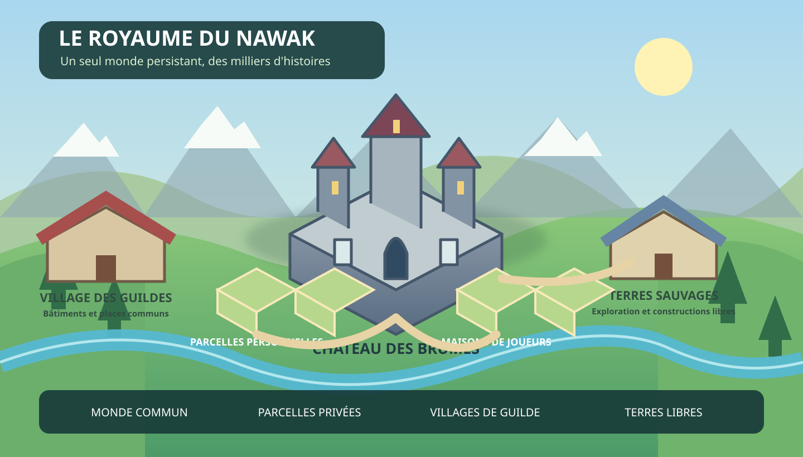
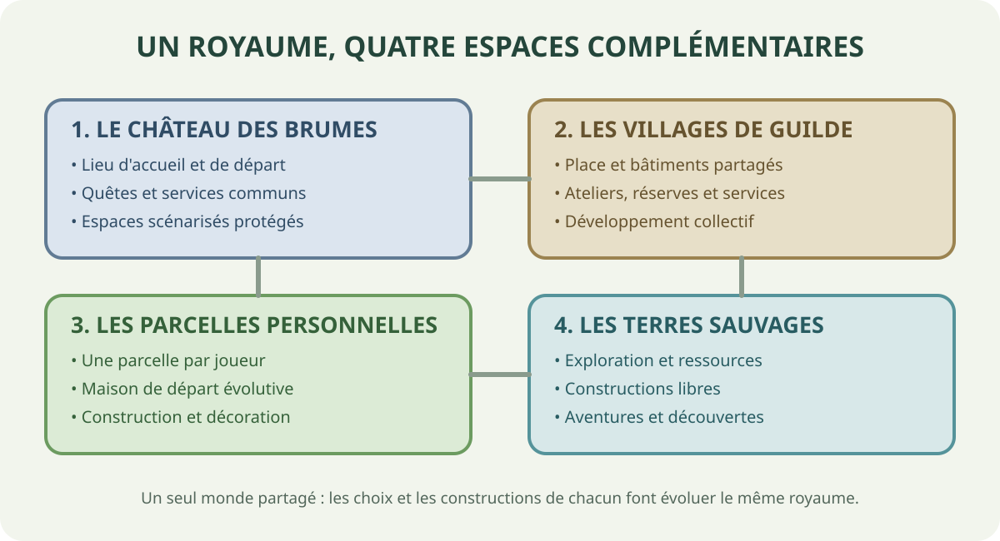
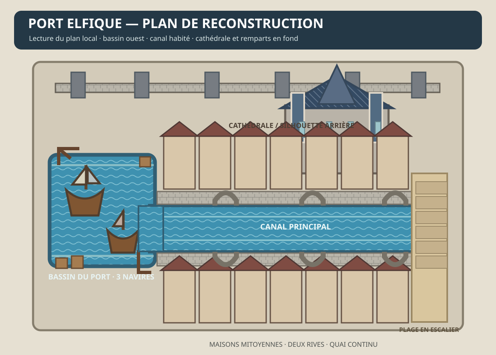

# Gros Débile Online

**Un MMORPG voxel libre, fédéré et multiplateforme — bienvenue au Royaume du Nawak !**

> Le monde a besoin de héros. On fait avec ce qu'on a.

Gros Débile Online (GDO) est un MMORPG fantasy humoristique construit autour de [Luanti](https://www.luanti.org/). Son univers, ses règles et ses outils sont conçus pour être modifiables, auto-hébergeables et réutilisables.

## Vision

- **Un vrai MMORPG** : monde ouvert, exploration, races, classes, progression, combat, magie, équipements, quêtes, donjons, boss et guildes.
- **Un humour familial et parodique** : fantasy épique, personnages improbables et situations absurdes.
- **Open source** : code, monde, quêtes, cartes et assets originaux publiés sous des licences libres clairement identifiées.
- **Fédéré** : intégration progressive d'ActivityPub pour les profils, guildes, actualités et événements.
- **Multiplateforme** : PC et Android en priorité ; compatibilité VR Meta Quest via un portage Luanti/OpenXR à valider.
- **Auto-hébergeable** : chacun doit pouvoir lancer son propre serveur et créer sa variante du Royaume du Nawak.

## Portage de l'expérience NLite

Le dépôt devient la base officielle du portage NLite vers Luanti. L'objectif est de retrouver ses grandes boucles RPG — races, classes, niveaux, loot, combat actif, magie, créatures, PNJ et montures — avec des modules Lua natifs et un budget serveur/client réduit. Aucun JAR Forge n'est chargé par GDO.

La première tranche ajoute dix races, trois classes, ressources et capacités raciales, quatre sorts, quatre armes, trois créatures hostiles, un spawn sauvage plafonné, une prime de chasse, une monnaie locale et deux montures de test. Les modèles et textures du modpack ne sont pas encore importés : ils nécessitent un audit des licences et un pipeline de conversion vers les formats utilisables par Luanti.

Voir [docs/nlite-port.md](docs/nlite-port.md) pour l'inventaire de l'archive, la correspondance des systèmes et les prochaines étapes.

## Le monde partagé

GDO repose sur **un seul Royaume du Nawak persistant**, commun à l'ensemble des joueurs du serveur officiel. Les régions sont conservées côte à côte dans le même monde :

1. **Le Port elfique NLite** : bassin à navires, canal entre des maisons mitoyennes, ponts, cathédrale, remparts et plage en escalier ; point d'apparition principal.
2. **Le Château des Brumes** : forteresse-école gothique, lieux de quêtes et espaces scénarisés.
3. **Les villages de guildes** : quatre villages fondateurs et villages créés par les joueurs.
4. **Les parcelles personnelles** : une parcelle et une maison de départ par joueur dans son village de guilde.
5. **Les terres sauvages** : zones d'exploration, de récolte, de combat et de construction libre.

Le Port elfique est reconstruit à partir des deux vues `elven.png` et `praiaelven.png` présentes dans l'archive NLite. L'archive ne contient pas de sauvegarde de monde ni de structure exportée ; la reproduction des volumes visibles est procédurale, sans prétendre copier les parties masquées au bloc près.







## État du projet

**Prototype RPG — première région urbaine ajoutée.** Le jeu possède une base locale jouable : personnage à créer, dix races, trois classes, progression XP, capacités, sorts, armes, créatures de test, première quête de chasse, monnaie locale et montures.

Le Port elfique est généré sur un emplacement continental validé au démarrage. Sa composition reprend les vues NLite : bassin avec navires, canal bordé de maisons mitoyennes, ponts arqués, cathédrale, remparts et plage en escalier. Si aucun site terrestre assez plat n'est disponible, les joueurs restent au château au lieu d'apparaître sous l'eau. Le Château des Brumes et les villages de guildes restent à leurs emplacements existants.

Les constructions de la cité et du château sont protégées. Le reste du monde demeure libre selon les règles GDO. Les nouvelles entités utilisent encore des formes cubiques et des textures provisoires. Le spawn naturel des créatures est plafonné et exclut les zones urbaines protégées.

## Démarrage rapide sous Linux

Voir [docs/quickstart-linux.md](docs/quickstart-linux.md).

```bash
git clone https://github.com/jeremiegoldberg/Grosdebile-online.git
cd Grosdebile-online
mkdir -p ~/.minetest/games
cp -a game/gdo ~/.minetest/games/gdo
luanti
```

Dans Luanti, crée un monde et sélectionne **Gros Débile Online** comme jeu. Sur un monde existant, la nouvelle cité sera générée dans sa région dédiée ; les anciennes régions ne sont pas reconstruites.

## Commandes principales

| Commande | Action |
|---|---|
| `/gdo_character` | Créer ou consulter son personnage |
| `/gdo_stats` | Afficher ses statistiques |
| `/gdo_ability` | Utiliser sa capacité raciale |
| `/gdo_spells` / `/gdo_spell` | Consulter et lancer les sorts |
| `/gdo_bestiary` | Afficher le bestiaire |
| `/gdo_quests` | Ouvrir le tableau des aventuriers |
| `/gdo_wallet` / `/gdo_pay` | Consulter ou transférer sa monnaie |
| `/gdo_city` | Rejoindre le Port elfique |
| `/gdo_castle` | Rejoindre le Château des Brumes |
| `/gdo_city_info` | Consulter l'état de génération de la cité |

Les administrateurs disposent aussi de `/gdo_city_rebuild` pour reconstruire uniquement l'emprise enregistrée du port. La commande ne déplace pas la carte et ne touche pas au château ni aux villages de guildes.

## Règles de construction et protection des zones

Le monde suit un modèle volontairement simple :
- **Zones de scénario en lecture seule** : le Port elfique, le Château des Brumes, ses pavillons et les lieux de tutoriel sont protégés.
- **Villages de guildes** : les bâtiments communs et parcelles suivent les droits de la guilde.
- **Monde libre en dehors** : aucun claim général ; les joueurs peuvent construire, modifier le paysage, creuser et démolir les constructions des autres.
- **Pas de protection automatique des bases sauvages** : construire quelque part ne confère pas de propriété exclusive sur cet endroit.

Les commandes `/gdo_zones`, `/gdo_guild`, `/gdo_plot` et `/gdo_progression` affichent les informations sur le monde et le personnage.

## Architecture cible

| Composant | Responsabilité |
|---|---|
| Client/serveur Luanti | Monde voxel, rendu, interactions et simulation |
| Jeu Lua `gdo` | Races, classes, combat, sorts, créatures, PNJ, quêtes, objets et progression |
| `gdo_city` | Région urbaine indépendante, génération versionnée et point d'apparition |
| Backend Go | Comptes web, personnages, services de guildes et API |
| PostgreSQL | Données persistantes métier |
| Service Fediverse | Identités ActivityPub, abonnements, actualités |
| Kubernetes/Docker | Déploiement reproductible et exploitation |

Le serveur Luanti reste autoritaire pour les actions de gameplay. Le service Fediverse est indépendant : une panne de fédération ne doit jamais empêcher de jouer.

## Licences

- Code : **GNU AGPL v3.0 ou ultérieure** (`AGPL-3.0-or-later`).
- Monde, documentation et assets originaux : **Creative Commons Attribution-ShareAlike 4.0 International** (`CC-BY-SA-4.0`), sauf mention contraire dans leur répertoire.
- Les marques, noms et logos « Gros Débile Online » et « Royaume du Nawak » ne sont pas concédés par les licences ci-dessus.
- Les ressources NLite et les contenus tiers ne sont pas redistribués sans vérification explicite de leurs conditions.

Les textes complets des licences et les notices de provenance doivent être ajoutés/vérifiés avant toute distribution publique d'une version logicielle ou d'un pack d'assets. Les dépendances et contenus tiers conservent leurs licences propres.

## Participer

Les contributions sont bienvenues : code, cartes, quêtes, traductions, tests, documentation et idées. Lire [CONTRIBUTING.md](CONTRIBUTING.md) avant de proposer une contribution.

---
Maintenu par la communauté de **Netasgard**. Le projet est indépendant de l'équipe Luanti et n'est pas affilié au projet officiel Luanti.
